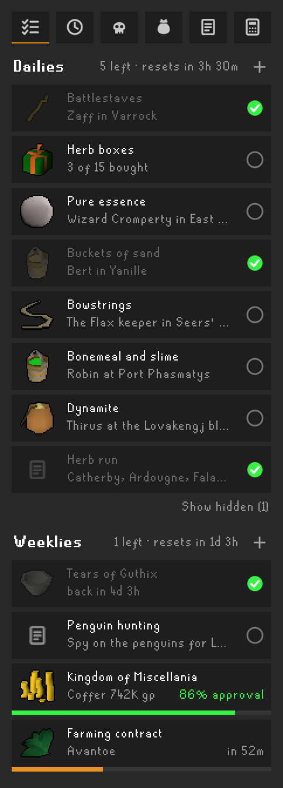
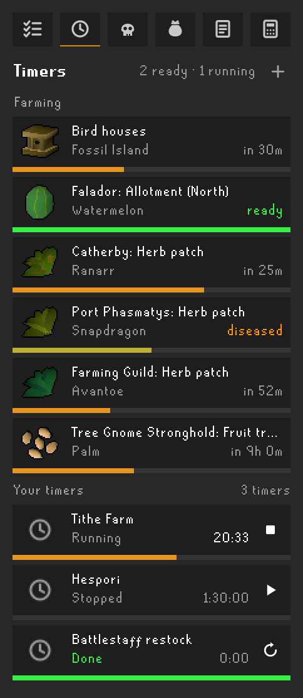
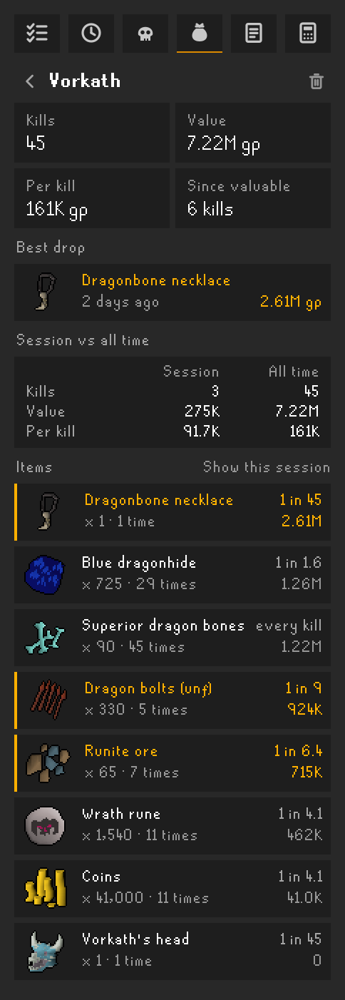
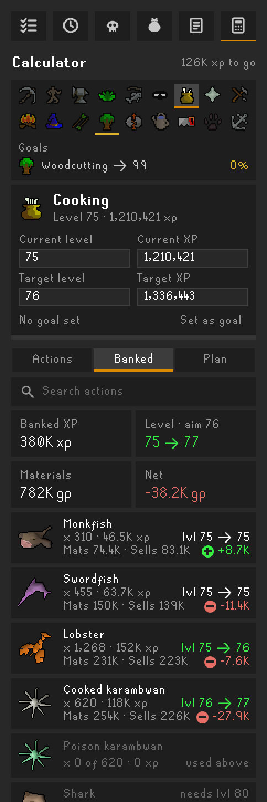
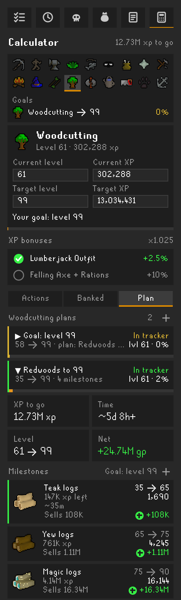

# Snuffy's Planner

A sidebar tab for dailies and weeklies, farming, bird house and your own timers, your Slayer task, a drop tracker, a to-do list with notes, and a skill calculator.

## Features

- **Today**: the daily rewards you've unlocked (battlestaves, herb boxes, essence, runes, sand, flax, bonemeal, dynamite, ogre arrows), ticked off as you collect them, plus your own dailies, with the time to the reset
- **Weekly**: Tears of Guthix, your own weeklies, the Kingdom of Miscellania's approval and coffer, and your farming contract
- **Timers**: every farming patch, compost bin and Hespori you've been to, bird houses and timers of your own, with ready alerts
- **Slayer**: your task, kills left, points and streak
- **Drops**: each monster or chest tracked on its own: kills, loot with the drop rates you've seen, Grand Exchange value, this session beside all time, and your latest drops
- **Notes & to-do**: a to-do list and a notes box for each account
- **Calculator**: pick a skill and a target (your goal, or the next level): every action with its XP (with the outfit, diary and altar bonuses you tick), how many to go, the time where the wiki's training guides give an XP rate, what the materials cost and the products are worth at Grand Exchange prices, what you own of it, and Set as goal (members-only actions left out on free worlds); Banked view shows the XP, level and value your bank gets you; Plan view makes a plan of milestones each with its own method (from the wiki's suggestions or by hand) with its XP, time and cost, and exports it to the Skilling Helper

## Screenshots

## Installing

In RuneLite, open the **Plugin Hub** (the plug icon at the bottom of the configuration panel), search for
**Snuffy's Planner** and click **Install**. Its settings are under its name in the configuration panel, and **Open the
Guide** in them links to the full feature guide.

It's one of Snuffy's plugins: install just the ones you want (Skilling Helper, PvM/Slayer, GemCrab Tracker, Tick Counter, Planner, and the optional Alerts for one voice across them); they work together. **Snuffy's Toolbelt** has all of them in one; don't install it together with the separate ones.

## Source and issues

Made by SgtSnufffy. Source: [bburge14/bradsmultitool](https://github.com/bburge14/bradsmultitool); ideas and
problems: [open an issue](https://github.com/bburge14/bradsmultitool/issues).
