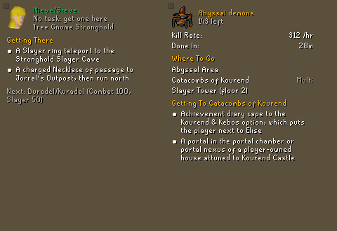
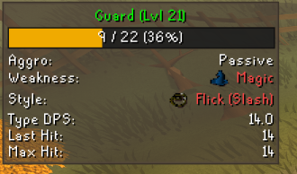
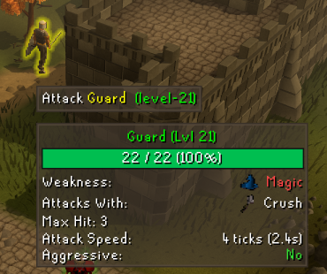
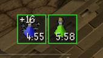

# Snuffy's PvM/Slayer

PvM HUD with loot per hour, monster hover card with weaknesses and max hits, buff bar, health, prayer and death alerts, Slayer card with points, streak and kill goals.

## Features

- **PvM HUD**: your target's health, weaknesses, what you're dealing and loot per hour
- **Monster hover card**: hitpoints, defences, weakness, max hit and attack speed
- **Buff bar**: potions, antifire, stamina, overload, vengeance, freezes and more, with low and expired alerts
- **Health and prayer warnings**, special attack ready, cannon, ammo and rune alerts, a death alert with a gravestone timer
- **Slayer card**: task, kills left and kill rate, where to go, points and streak with milestone warnings, supplies used, kill goals; task monster outlines and finish-off markers

## Screenshots

## Installing

In RuneLite, open the **Plugin Hub** (the plug icon at the bottom of the configuration panel), search for
**Snuffy's PvM/Slayer** and click **Install**. Its settings are under its name in the configuration panel, and **Open the
Guide** in them links to the full feature guide.

It's one of Snuffy's plugins: install just the ones you want (Skilling Helper, PvM/Slayer, GemCrab Tracker, Tick Counter, Planner, and the optional Alerts for one voice across them); they work together. **Snuffy's Toolbelt** has all of them in one; don't install it together with the separate ones.

## Source and issues

Made by SgtSnufffy. Source: [bburge14/bradsmultitool](https://github.com/bburge14/bradsmultitool); ideas and
problems: [open an issue](https://github.com/bburge14/bradsmultitool/issues).
