# Snuffy's Toolbelt

All of Snuffy's plugins in one: Skilling Helper, PvM/Slayer, GemCrab Tracker, Tick Counter, Planner and Alerts.

## Features

Everything in Snuffy's six separate plugins, in one plugin:

**Snuffy's Skilling Helper**

- **XP tracker** in the sidebar: XP/hr, time to level, actions left, items gathered per hour, auto-pause, a pinned skill on screen, and it keeps your session through a quick restart
- **Goals** with the wiki's training method for your level, outlined in the world, banked XP and materials value, Track for goal, goal bars on the Skills tab, and skill plans exported from Snuffy's Planner (the milestone you're on, with its own bar and method)
- **Hover cards** for trees, rocks, fishing spots, stalls, pickpocketing, farming patches, Hunter, Runecraft, Agility, Cooking, Smithing and Sailing
- **Resource timers**: tree, rock, fishing spot, trap, fire and shipwreck timers
- **Hunters' Rumours** card: the creature, catches toward the rare part and where to find it
- **Agility**: course and Brimhaven arena cards, the quickest route to the tagged pillar, one-obstacle training
- **Minigames**: Wintertodt, Tempoross and Guardians of the Rift cards and alerts
- **Voice alerts**: inventory full, resource gone, Forestry events, bird nests, Motherlode sack full, boat health, level-ups and more

**Snuffy's PvM/Slayer**

- **PvM HUD**: your target's health, weaknesses, what you're dealing and loot per hour
- **Monster hover card**: hitpoints, defences, weakness, max hit and attack speed
- **Buff bar**: potions, antifire, stamina, overload, vengeance, freezes and more, with low and expired alerts
- **Health and prayer warnings**, special attack ready, cannon, ammo and rune alerts, a death alert with a gravestone timer
- **Slayer card**: task, kills left and kill rate, where to go, points and streak with milestone warnings, supplies used, kill goals; task monster outlines and finish-off markers

**Snuffy's GemCrab Tracker**

- **Gemstone Crab HUD** with the crab's health and the burrow countdown
- **Radar** pointing to the next cove when the crab burrows
- **Gear check**, outlines of the crab, its shell and the tunnels, and voice alerts

**Snuffy's Tick Counter**

- **Tick count** over your head, as numbered tick boxes or a smooth tick bar
- **Metronome** with a play-ahead option, and hotkeys to reset, hide and change the cycle
- **Attack timer** that follows your weapon's speed, counting up or down to your next attack

**Snuffy's Planner**

- **Today**: your own dailies, ticked off by you and due again at the daily reset
- **Weekly**: Tears of Guthix, your own weeklies, the Kingdom of Miscellania's approval and coffer, and your farming contract
- **Timers**: every farming patch, compost bin and Hespori you've been to, bird houses and timers of your own, with ready alerts
- **Slayer**: your task, kills left, points and streak
- **Drops**: each monster or chest tracked on its own: kills, loot with the drop rates you've seen, Grand Exchange value, this session beside all time, and your latest drops
- **Notes & to-do**: a to-do list and a notes box for each account
- **Calculator**: pick a skill and a target (your goal, or the next level): every action with its XP (with the outfit, diary and altar bonuses you tick), how many to go, the time where the wiki's training guides give an XP rate, what the materials cost and the products are worth at Grand Exchange prices, what you own of it, and Set as goal (members-only actions left out on free worlds); Banked view shows the XP, level and value your bank gets you; Plan view makes a plan of milestones each with its own method (from the wiki's suggestions or by hand) with its XP, time and cost, and exports it to the Skilling Helper

**Snuffy's Alerts**

- **One voice and volume** for all of Snuffy's plugins (4 voices)
- **Idle alerts**: AFK, about to be logged out, six-hour logout
- **Run energy** low and restored alerts
- **Clue drops** from monsters and skilling

## Screenshots

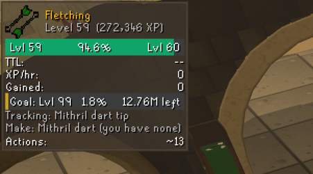
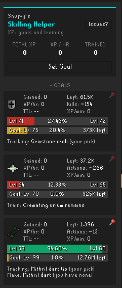
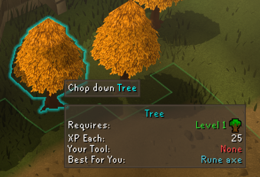
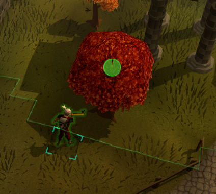
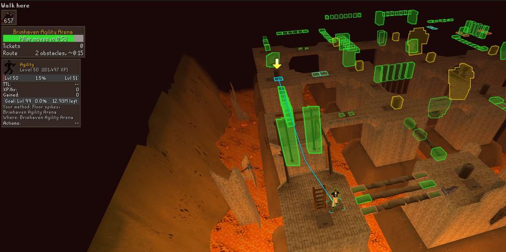
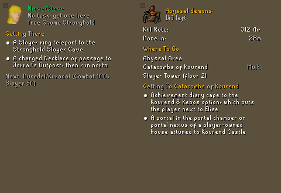
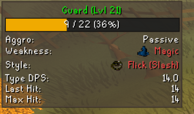
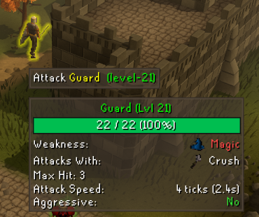
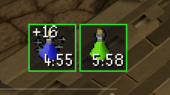
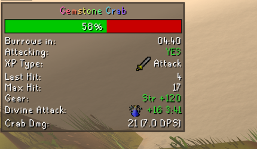
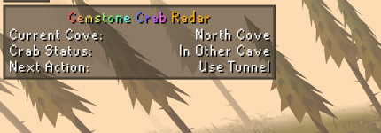
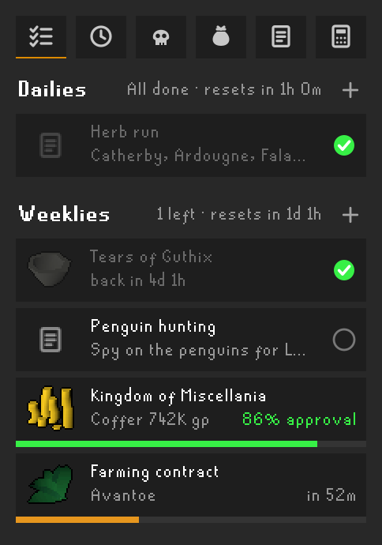
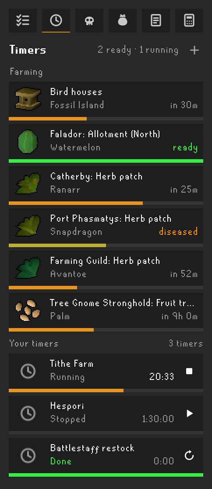
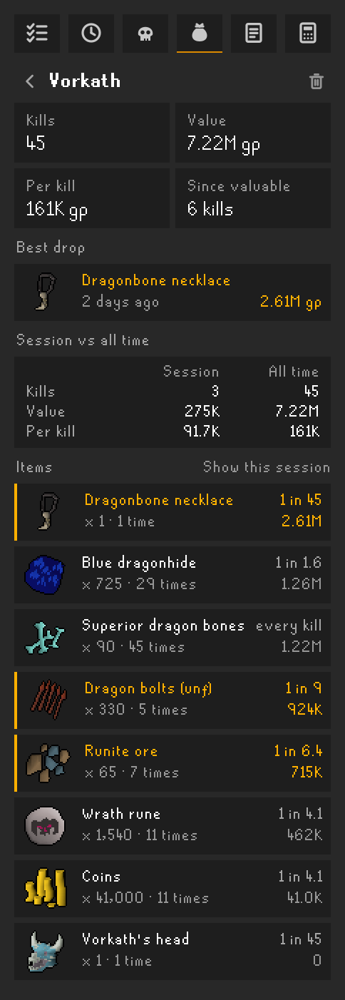
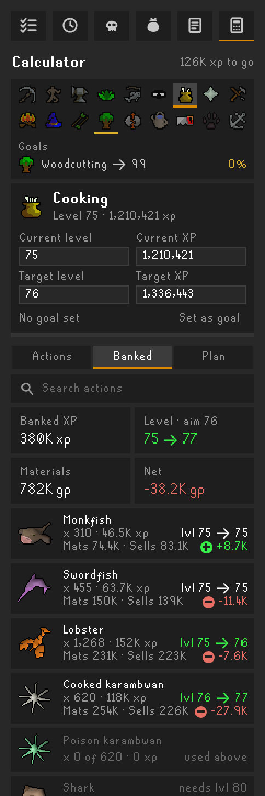
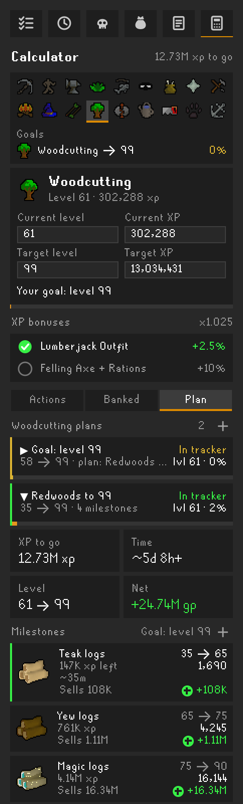
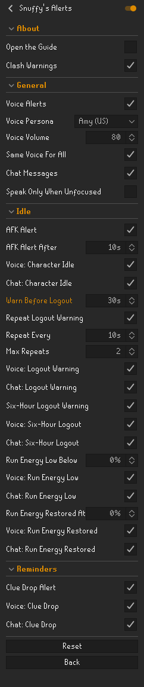

## Installing

In RuneLite, open the **Plugin Hub** (the plug icon at the bottom of the configuration panel), search for
**Snuffy's Toolbelt** and click **Install**. Its settings are under its name in the configuration panel, and **Open the
Guide** in them links to the full feature guide.

This is all of Snuffy's plugins together. Install either the Toolbelt or the separate ones you want (Skilling Helper, PvM/Slayer, GemCrab Tracker, Tick Counter, Planner, Alerts), not both.

## Source and issues

Made by SgtSnufffy. Source: [bburge14/bradsmultitool](https://github.com/bburge14/bradsmultitool); ideas and
problems: [open an issue](https://github.com/bburge14/bradsmultitool/issues).
